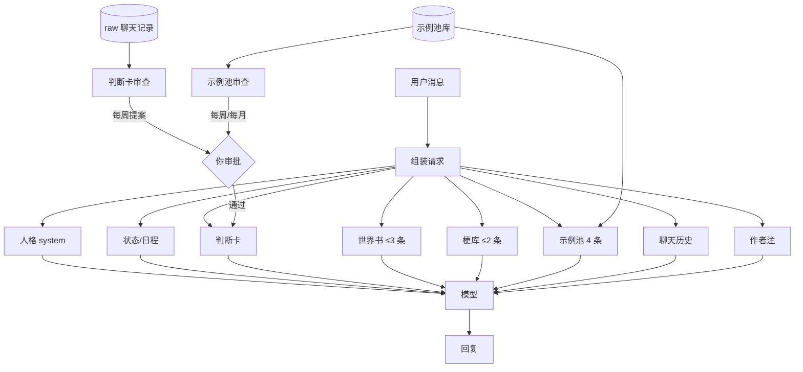

# AstrBot Companion Memory Kit

> 不训练模型，给你的 AI 角色一套**会成长、可审批、不会污染人格**的外置记忆。
>
> 两个系统：**判断卡**（她记得关于你的事）和**示例池**（她说话的样子）。再加一套**角色模式**（艾莉丝 / 女仆）。

[](https://github.com/AstrBotDevs/AstrBot)
[](https://www.python.org/)
[](LICENSE)
[](CONTRIBUTING.md)

---

## 快速开始（3 步，约 5 分钟）

> 前提：已经装好 AstrBot（[官方安装包](https://github.com/AstrBotDevs/AstrBot/releases)），并且能在 WebUI 里看到「插件」。

**方式 A：没有 Git 也能装**

1. 打开仓库页 → 绿色 Code → Download ZIP
2. 解压到任意英文目录
3. 双击 install.bat

**方式 B：有 Git**

`powershell
git clone https://github.com/chenxi806/astrbot-companion-kit.git
cd astrbot-companion-kit
.\install.bat
`

安装器会自动：

1. 找到你的 AstrBot 数据目录（找不到会问你）
2. 复制 15 个插件
3. 建好 memory\ 并复制模板
4. 按你的路径生成插件配置
5. 把示例人格写进数据库

跑完只剩两件事，在 WebUI 里做一次：

- **模型提供商**：填 DeepSeek API Key（Base https://api.deepseek.com/v1，模型 deepseek-flash）
- **消息平台**：QQ 官方机器人，填 AppID / AppSecret / Token，把 QQ 号加进沙箱

然后重启 AstrBot，私聊发「你好」。

### 只想先看看？

`powershell
.\install.ps1 -DataDir E:\bot\instances\xxx\core\data -MemoryDir D:\companion\memory
`

### 用 Docker

`powershell
docker compose up -d
`

镜像名以 [AstrBot 文档](https://astrbot.app) 为准。

---

## 它解决什么问题

和 AI 角色聊久了，通常会遇到三个问题：

| 问题 | 常见做法 | 后果 |
|---|---|---|
| 她记不住你 | 把记忆全塞进 system prompt | 越塞越长，人格被稀释 |
| 她不会长 | 手动改人格 | 改一次要重启，越改越乱 |
| 她长歪了 | 自动总结、自动写入 | 一句气话变成永久规则 |

这套东西的思路是：

> **记忆外置、增长可审、存用分离。**

- 记忆不写在人格里，写在文件里，每轮按场景取几段。
- 新内容先攒成提案，你点头才进卡。
- 示例池分“库”和“上场名单”：喜欢的句子不会因为上限被删掉。

---

## 两个核心系统

### 1. 判断卡：她记得关于你的事

四类内容，各自有生命周期：

| 类型 | 记什么 | 进卡 | 上限 |
|---|---|---|---|
| 事实 fact | 生日、课表、忌口、称呼 | ✅ | 30 |
| 判断 judgment | “以后怎么做”的规则 | ✅ | 40 |
| 雷区 taboo | 绝对不碰的底线 | ✅ | 10 |
| 洞察 insight | 还不确定的观察 | ❌ | 50 |

流程：

```
聊天 → 每周自动提取 → 待审清单 → 你回「通过 1,3」→ 写进卡
```

每月再做一次大清理：合并相似判断、归档低分、把证据足够的洞察升成判断。

### 2. 示例池：她说话的样子

```
/good  → 收藏她上一句
/bad   → 标记不喜欢
```

池子分两层：

- **库**：不限量，所有你喜欢的句子都在
- **上场名单**：按权重抽 4 条注入，上限 24~60

上限到了只“降级”，不删除。你喜欢的句子不会因为名额被丢掉。

### 3. 角色模式：艾莉丝 / 女仆

说一句「艾莉丝模式」就进，10 分钟后自动退出，或者说「退出」立刻恢复。

- **不是换人**：底层还是原来的角色，会露馅、会羞耻
- **不污染记忆**：模式里的聊天会打标记，判断卡提取时跳过
- **语言分离**：艾莉丝文字用中文，语音才是日语

---

## 它是怎么工作的



关键点：

- **人格只放骨架**，细节放世界书和记忆文件。
- **每轮只取少量**：世界书 3 条、梗库 2 条、示例 4 条。少而准比多而杂有效。
- **审批在写入之前**，避免自动总结把临时情绪固化。

---

## 功能一览

| 功能 | 说明 |
|---|---|
| 判断卡 | 事实 / 判断 / 雷区 / 洞察，每轮注入 |
| 自动提取 | 读 raw，提炼四类，生成带证据的待审清单 |
| 逐条审批 | `通过 1,3`、`驳回 2`，不通过不生效 |
| 月度清理 | 合并相似、归档低分、洞察升级 |
| 示例池 | `/good` `/bad`，按权重抽样 |
| 示例池审查 | 查重、单场景超配、长期没抽中 |
| 角色模式 | 艾莉丝 / 女仆，文字进出、10 分钟超时 |
| 模式隔离 | raw 打标记、判断卡跳过、示例归档 |
| 中文/日语分离 | 艾莉丝文字中文，语音日语 |
| 语音门禁 | 只有艾莉丝模式能发；退出后拒绝 |

---

## 快速开始

### 环境

- AstrBot `>= 4.24`
- Python `3.10+`
- 一个可用的 LLM Provider

### 安装

1. 把 `plugins/` 下五个目录复制到 AstrBot 的插件目录：

```
<AstrBot>/data/plugins/
```

2. 每个插件复制一份配置模板：

```
config/astrbot_plugin_memory_card_config.json
config/astrbot_plugin_card_review_config.json
config/astrbot_plugin_voice_pool_config.json
config/astrbot_plugin_pool_review_config.json
config/astrbot_plugin_mode_switch_config.json
```

放到：

```
<AstrBot>/data/config/
```

3. 把 `memory-template/` 复制到你想放记忆的目录，例如：

```
D:\companion-memory\
```

4. 修改每个配置里的 `memory_dir`，指向上一步的目录。

5. 重启 AstrBot。

### 第一次验证

```
/card
/审批
/通过
/good
/pool
```

### 进入模式

```
艾莉丝模式
（聊几句）
退出
```

---

## 命令表

### 判断卡

| 命令 | 作用 |
|---|---|
| `/审批` | 立刻从聊天提取，生成待审 |
| `/待审` | 看当前待审 |
| `/通过` | 全部写入 |
| `/通过 1,3` | 只写这几条 |
| `/驳回 2` | 不要这条 |
| `/月审` | 看月度报告 |
| `/月通过 1,3` | 执行月度项 |
| `/card` | 看四类计数 |
| `/card list` | 看判断编号 |
| `/记 内容` | 手动加判断 |
| `/事实 内容` | 手动加事实 |
| `/雷区 内容` | 手动加雷区 |
| `/观察 内容` | 手动加洞察 |
| `/忘 id` | 归档某条 |

### 示例池

| 命令 | 作用 |
|---|---|
| `/good` / `/存` | 收藏她上一句 |
| `/bad` / `/差` | 标记不喜欢 |
| `/pool` | 看池子状态 |
| `/池审` | 看周审查 |
| `/池通过 1,3` | 执行周审查 |
| `/池月审` | 看月度审查 |
| `/池月通过 1,3` | 执行月度审查 |

### 模式

| 说 | 作用 |
|---|---|
| 艾莉丝模式 | 进入艾莉丝，10 分钟 |
| 女仆模式 / 换女仆装 | 进入女仆，10 分钟 |
| 退出 / 回来 / 变回来 | 恢复 |
| 妹妹，我们来玩角色扮演吧 | 她问 1 艾莉丝 / 2 女仆，回数字进入 |

---

## 数据长什么样

```
memory/
├── card/
│   ├── store.json            判断卡源数据
│   ├── card.md               人读版
│   ├── pending.json          待审
│   └── monthly_pending.json  月度待执行
├── voice_pool/
│   ├── examples.jsonl        喜欢的句子
│   └── bad.jsonl             不喜欢
├── modes/
│   ├── state.json            当前模式
│   └── alice_corpus.json     艾莉丝语料
└── raw/
    └── 2026-10-28.jsonl      聊天记录
```

判断卡一条记录：

```json
{
  "id": "j251028143000",
  "type": "judgment",
  "text": "以后别在半夜讲道理",
  "confidence": 0.85,
  "status": "active",
  "source": "user",
  "evidence": [{"date": "10-28", "quote": "原话"}],
  "created": "2026-10-28",
  "updated": "2026-10-28"
}
```

示例一条记录：

```json
{
  "id": "e251028...",
  "text": "过来。（拍了拍身边）先坐会儿。",
  "scene": "累",
  "likes": 3,
  "picked": 12,
  "status": "active",
  "score": 0.62
}
```

---

## 设计原则

### 1. 存用分离

判断卡是“全文注入”，所以有字数预算；示例池是“抽样注入”，所以库可以很大，只有上场名单有名额。

### 2. 证据优先

自动提取的每条内容都必须带一句原话。没有证据的推测只进洞察，不进判断。

### 3. 审批在写入前

不即时写卡。每周只生成提案，你回「通过」才生效。避免一句气话变成永久规则。

### 4. 归档不是删除

判断和示例都只改 `status`，数据还在文件里。随时可以恢复。

### 5. 模式不污染主线

模式中的 raw 带 `mode` 字段，判断卡提取跳过；模式中的示例默认归档，不进日常抽样。

---

## 测试

```bash
python tests/run.py
```

覆盖：

- 判断卡新增、合并、上限、四类、渲染、归档
- 月度生成与执行
- 待审部分通过
- 示例池 `/good` `/bad`、权重抽样、池审
- 模式文字进出、10 分钟超时、中文样本
- 部署文件与配置合法性

> 测试使用临时目录，不会动你的真实记忆。

---

## 隐私

- 不包含任何真实聊天记录、真实人格、API Key。
- 所有数据都在你自己的 `memory_dir` 里，纯文本，可读可删。
- 插件不主动上传数据；只有你配置的 LLM Provider 会收到请求。

---

## 已知限制

- 周/月定时任务依赖 AstrBot 进程常驻。
- QQ 官方接口的主动消息有频率和权限限制。
- 模式超时检查发生在下一轮请求，不是精确定时器。
- 艾莉丝语料是社区整理 + 重写，不含原作长段落。
- 不包含 TTS；日语语音需要额外配置。

---

## 文档

| 文档 | 内容 |
|---|---|
| [架构](docs/01-architecture.md) | 注入顺序、数据流、为什么这样拆 |
| [快速开始](docs/02-quickstart.md) | 从零部署 |
| [判断卡](docs/03-judgment-card.md) | 四类、字段、生命周期、审批 |
| [示例池](docs/04-example-pool.md) | 库/上场、权重、审查 |
| [角色模式](docs/05-modes.md) | 艾莉丝/女仆、隔离、语料 |
| [运维](docs/06-operations.md) | 每周/每月、故障排查 |
| [设计取舍](docs/07-design.md) | 为什么不做自动写入 |
| [FAQ](docs/08-faq.md) | 常见问题 |

---

## 目录结构

```
.
├── README.md
├── LICENSE
├── CONTRIBUTING.md
├── CHANGELOG.md
├── config/                 # 配置模板
├── memory-template/        # 空记忆模板
├── plugins/                # 5 个 AstrBot 插件
│   ├── astrbot_plugin_memory_card/
│   ├── astrbot_plugin_card_review/
│   ├── astrbot_plugin_voice_pool/
│   ├── astrbot_plugin_pool_review/
│   └── astrbot_plugin_mode_switch/
├── scripts/                # 安装/校验脚本
├── tests/                  # 自检
└── docs/
```

---

## English

**AstrBot Companion Memory Kit** gives your AI companion a growing, approval-gated memory without retraining or prompt bloat.

- **Judgment Card** — facts, rules, taboos, and observations about the user, extracted weekly and approved by you.
- **Example Pool** — lines you liked, sampled by weight; a separate active roster keeps the injection small.
- **Modes** — roleplay modes that don't contaminate long-term memory.

Plain-text storage, MIT licensed, no telemetry.

---

## 致谢

- [AstrBot](https://github.com/AstrBotDevs/AstrBot) — 插件框架
- [BAAI/bge-m3](https://huggingface.co/BAAI/bge-m3) — 语义相似度（可选）
- 萌娘百科与公开角色资料 — 艾莉丝人设参考（CC BY-NC-SA 3.0 CN，台词为按人设重写）

## License

MIT
