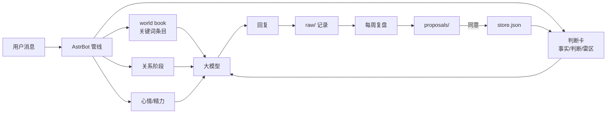

# AstrBot Companion Kit

> 给聊天机器人一套「会记事、会变、会随机」的外置大脑。
> 六个 AstrBot 插件 + 一套纯文本记忆库，不训练模型，不依赖云服务。

[](https://github.com/AstrBotDevs/AstrBot)
[](LICENSE)
[](https://www.python.org/)

---

## 它解决什么问题

和 AI 角色聊久了，通常会遇到三个问题：

1. **它记不住。** 明天开新对话，今天的事全忘；它只记得系统提示里写死的设定。
2. **它很僵。** 情绪、关系、语气永远是同一条水平线；你说十句话，它十句一个腔调。
3. **它不会成长。** 聊了一个月，它对你的理解还停在第一天；你变了，它不知道。

这套工具的思路是：**模型不会变，但它的「记忆」和「状态」可以变。**

- 记忆放在外部文件里，每次对话前注入——所以能积累、能修改、能回滚。
- 人格拆成「常驻核心 + 按关键词触发的小条目」——所以更厚，也更随机。
- 关系用阶段推进，心情用慢变量漂移——所以行为有连续性，不是随机换措辞。

> 先说清楚边界：这**不是**让模型真的「记住」你。它每次读到的都是一份外部档案。
> 档案写得好，它就像认识你；档案写错了，它会一直错，而且越用越像真的。

---

## 功能一览

| 插件 | 一句话 | 依赖 |
|---|---|---|
| `astrbot_plugin_growth_card` | 把判断卡注入每轮对话，记录问答 | 无 |
| `astrbot_plugin_lorebook` | 人格分片：关键词 + 概率触发 | 无 |
| `astrbot_plugin_galgame` | 关系阶段：认识 → 熟悉 → 亲近 → 亲密 | 无 |
| `astrbot_plugin_state` | 心情/精力慢漂移 + whim 小事池 | 无 |
| `astrbot_plugin_daily_ritual` | 早 8 点叫起床、0 点催睡 | 无 |
| `astrbot_plugin_weekly_review` | 每周复盘：事件 → 洞察 → 判断 | LLM |

配套的记忆库（纯文本 + 一个渲染脚本）：

- `store.json`：事实 / 判断 / 雷区 / 洞察
- `card.md` + `card.companion.txt`：渲染出来的判断卡
- `events/`：事件流（只追加）
- `raw/`：真实问答记录（插件自动写）
- `proposals/`：复盘提案

---

## 架构



**注入顺序**：人格（system）→ 判断卡 → 世界书 → 关系阶段 → 状态。后四者都走「临时用户内容」通道，不写进历史，也不影响前缀缓存。

**一个关键设计**：不碰模型权重。所有「成长」都发生在 `store.json` 和状态文件里，所以随时可以查、改、回滚。

---

## 五分钟上手

### 0. 前提

- 一个能跑的 [AstrBot](https://github.com/AstrBotDevs/AstrBot)（v4.24 以上）
- 一个能收私聊的平台（QQ 官方机器人 / Telegram / WebChat 都行）
- 会改 JSON、会用命令行

### 1. 拿到插件

```bash
git clone https://github.com/chenxi806/astrbot-companion-kit.git
```

把 `plugins/` 下的六个目录复制到 AstrBot 的插件目录：

```
<AstrBot>/data/plugins/
├── astrbot_plugin_growth_card/
├── astrbot_plugin_lorebook/
├── astrbot_plugin_galgame/
├── astrbot_plugin_state/
├── astrbot_plugin_daily_ritual/
└── astrbot_plugin_weekly_review/
```

Windows 可以用自带脚本：

```powershell
.\scripts\install.ps1 -AstrBotData "E:\bot\instances\<id>\core\data"
```

### 2. 建记忆目录

```powershell
.\scripts\init-memory.ps1 -Target "E:\bot\instances\<id>\core\data\companion_memory"
```

它会从 `memory-template/` 复制一份 `store.json`、`render.py`、`whims.json`、`lorebook.json` 过去。

### 3. 改配置

每个插件都有一个同名配置文件，在 `<AstrBot>/data/config/` 下。**六个插件的 `memory_dir` 必须填同一个路径**：

```json
{
  "memory_dir": "E:\\bot\\instances\\<id>\\core\\data\\companion_memory"
}
```

`astrbot_plugin_growth_card` 还要填 `card_path`：

```json
{
  "card_path": "E:\\bot\\instances\\<id>\\core\\data\\companion_memory\\card.companion.txt"
}
```

### 4. 重启

AstrBot 不会热加载新插件，必须重启一次。重启后看日志，应该出现：

```
Loading plugin astrbot_plugin_growth_card ...
Loading plugin astrbot_plugin_lorebook ...
...
```

### 5. 验证

私聊依次发：

| 命令 | 预期 |
|---|---|
| `/card` | 输出判断卡 |
| `/lore` | 输出世界书条数 |
| `/stage` | 输出关系阶段 |
| `/state` | 输出心情/精力 |
| `/review status` | 输出下次复盘时间 |

任何一个没反应，看 [常见问题](docs/06-常见问题.md)。

---

## 最小可用路径

不想一次装六个？只装两个就够跑：

1. `astrbot_plugin_growth_card`（注入判断卡 + 记录问答）
2. 记忆目录里的 `store.json` + `render.py`

这样你就有了「跨会话记忆」；世界书、阶段、状态都可以后加。

---

## 推荐阅读顺序

1. [为什么需要这套](docs/01-为什么需要这套.md) — 先理解模型不会成长这件事
2. [架构与数据流](docs/02-架构.md) — 六个插件怎么协作
3. [快速开始](docs/03-快速开始.md) — 逐步安装
4. [配置手册](docs/04-配置手册.md) — 每个参数什么意思
5. [插件详解](docs/05-插件详解.md) — 每个插件的行为和边界
6. [常见问题](docs/06-常见问题.md) — 报错、没反应、重复发
7. [设计取舍](docs/07-设计取舍.md) — 为什么不做什么

---

## 目录结构

```
.
├── plugins/                 # 六个 AstrBot 插件
├── memory-template/         # 记忆库模板（store/render/whims/lorebook/核心人格示例）
├── scripts/                 # 安装、初始化脚本
├── docs/                    # 中文文档
├── CHANGELOG.md
└── LICENSE
```

---

## 已知限制

- **不是真记忆**：模型每次读的是外部文本，档案错了它会一直错。
- **QQ 官方机器人的主动消息有限制**：早晚安/复盘通知属于主动推送，可能被平台限流或折叠；具体看平台文档。
- **插件不热加载**：改代码、装新插件都要重启。
- **embedding 是可选依赖**：只有你想用「模糊回忆」时才需要配向量模型；本套的记忆是纯文本，不依赖 embedding。
- **多设备/多实例**：记忆目录是本地文件，没有同步机制。要同步自己上 Git 或网盘。

---

## 致谢与参考

设计上参考了这些公开工作（只借架构，不抄内容）：

- [Generative Agents](https://github.com/joonspk-research/generative_agents)：memory stream / retrieval / reflection
- [A-MEM](https://github.com/agiresearch/A-mem)：记忆演化与链接
- [Graphiti](https://github.com/getzep/graphiti)：带有效期的事实
- [Letta](https://github.com/letta-ai/letta)：核心记忆块与睡眠代理
- [SillyTavern](https://github.com/SillyTavern/SillyTavern)：世界书 / 提示词分层
- [mem0](https://github.com/mem0ai/mem0)：ADD / UPDATE / DELETE / NOOP

## License

MIT
