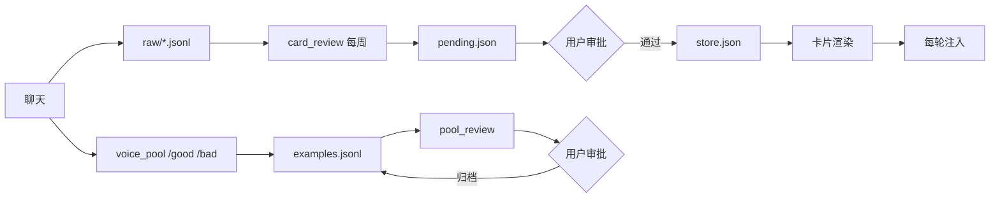

# 架构

## 目标

给已经存在的 AI 角色加一层“外置记忆”，要求：

1. 不改人格、不训练模型
2. 每轮只注入少量内容，不稀释人格
3. 新内容可审批、可回滚
4. 角色扮演不污染长期记忆

## 一次请求的组装顺序

| 顺序 | 内容 | 来源 | 预算 |
|---|---|---|---|
| 1 | 核心人格 | AstrBot persona | 全文 |
| 2 | 状态/日程 | 其他插件（可选） | 少量 |
| 3 | 判断卡 | `memory_card` | ≤1800 字 |
| 4 | 世界书 | 其他插件（可选） | ≤3 条 |
| 5 | 梗库 | 其他插件（可选） | ≤2 条 |
| 6 | 示例池 | `voice_pool` | 4 条 |
| 7 | 长期记忆 | 其他插件（可选） | 少量 |
| 8 | 聊天历史 | AstrBot | 最近若干轮 |
| 9 | 作者注 | 其他插件（可选） | 最后一行 |

越靠后，模型越敏感。判断卡放在中段，是因为它影响决策但不需要抢语气；示例池放在后段，是为了让“怎么说”压过“说什么”。

## 数据流

## 模块职责

| 插件 | 职责 | 不做什么 |
|---|---|---|
| `memory_card` | 存四类记忆、渲染、每轮注入、写 raw | 不主动总结 |
| `card_review` | 每周提取、月度合并归档、审批 | 不直接写卡 |
| `voice_pool` | 收藏、权重抽样、注入 | 不做聚类 |
| `pool_review` | 查重、超配、归档建议 | 不删除数据 |
| `mode_switch` | 模式状态、注入角色卡、隔离标记 | 不改人格 |

## 为什么拆成四个插件

- **写入**和**审批**分开：写入是确定性的，审批需要模型和你的判断。
- **展示**和**整理**分开：展示每轮都要跑，整理一周一次。
- 一个插件坏了，不影响另一个系统。

## 存储原则

- 全部是纯文本 JSON / JSONL，可读、可 diff、可手改。
- 写入用临时文件 + `replace`，避免写一半损坏。
- 归档只改 `status`，不删记录。

## 失败模式

| 失败 | 表现 | 处理 |
|---|---|---|
| 模型提取失败 | `/审批` 报错 | 检查 Provider；不会写坏数据 |
| 待审 JSON 损坏 | `/待审` 空 | 从备份恢复；文件是普通 JSON |
| 模式状态残留 | 一直保持角色 | 发「退出」；或删 `modes/state.json` |
| 注入过长 | 回复变慢/变钝 | 降低示例数或判断卡预算 |
