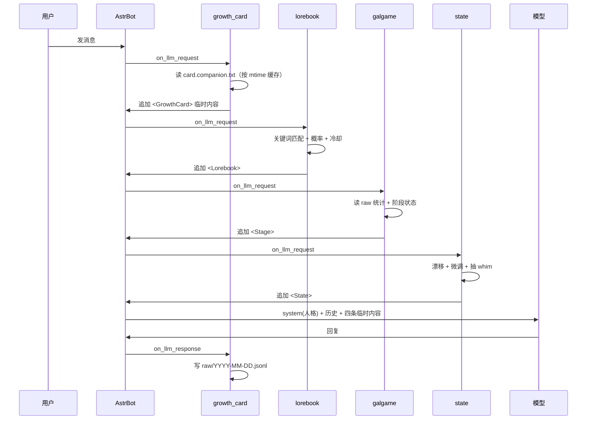
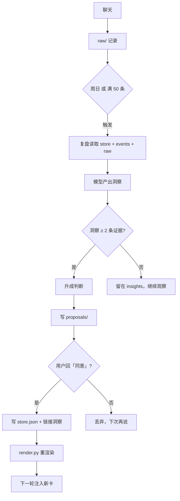

# 架构与数据流

## 一、组件

```
plugins/
├── astrbot_plugin_growth_card     # 注入判断卡 + 记录 raw
├── astrbot_plugin_lorebook        # 世界书：关键词 + 概率
├── astrbot_plugin_galgame         # 关系阶段 + 事件 + 选项
├── astrbot_plugin_state           # 心情/精力 + whim
├── astrbot_plugin_daily_ritual    # 早晚安定时消息
└── astrbot_plugin_weekly_review   # 周复盘：事件→洞察→判断
```

六个插件共享一个 `memory_dir`，互不直接调用，只通过文件协作：

```
memory_dir/
├── store.json           # 事实/判断/雷区/洞察
├── card.md              # 渲染结果（人看）
├── card.companion.txt   # 渲染结果（模型看）
├── render.py            # 渲染脚本
├── lorebook.json        # 世界书条目
├── whims.json           # 状态机的小事池
├── events/YYYY-MM.md    # 事件流
├── raw/YYYY-MM-DD.jsonl # 真实问答
└── proposals/           # 复盘提案
```

## 二、一次请求发生了什么



要点：

- 四条临时内容都走 `extra_user_content_parts` + `mark_as_temp()`，**不会写进历史**，也不会破坏前缀缓存。
- 顺序按插件加载顺序；每条带自己的 `<Tag>` 边界，重试时会先清掉旧的再注入，不会叠加。
- 人格仍然是 system prompt，最先读到，优先级最高。

## 三、记忆的生命周期



## 四、store.json 字段

```json
{
  "version": 1,
  "updated": "2026-10-27",
  "facts": [
    {"id": "birthday", "text": "生日 1 月 15 日", "scope": ["companion"], "confidence": 1.0}
  ],
  "judgments": [
    {
      "id": "companion-tired",
      "text": "累了先接情绪，别讲道理",
      "scope": ["companion"],
      "confidence": 0.7,
      "status": "active",
      "created": "2026-10-26",
      "updated": "2026-10-26",
      "supersedes": null,
      "insights": ["i-20261027-1"],
      "evidence": [{"date": "10-26", "quote": "他说今天好累"}]
    }
  ],
  "taboos": [],
  "insights": [
    {
      "id": "i-20261027-1",
      "text": "他会反复确认我还在不在",
      "confidence": 0.55,
      "status": "emerging",
      "evidence": [{"date": "10-26", "quote": "怎么不理我了"}],
      "promoted_to": null
    }
  ]
}
```

- `scope`：`companion`（陪聊）/ `dev`（编程助手）/ 两者
- `status`：`active` / `superseded` / `archived`
- 洞察 `status`：`emerging` → `reinforced` → `promoted` / `dropped`

## 五、状态文件

| 文件 | 内容 |
|---|---|
| `plugin_data/astrbot_plugin_galgame/state.json` | 阶段、共同事件数、待选选项 |
| `plugin_data/astrbot_plugin_state/state.json` | mood、energy、当天 whim 次数 |
| `plugin_data/astrbot_plugin_weekly_review/state.json` | 待审提案、上次运行、触发计数 |

删掉这些文件等于重置对应系统；`store.json` 不受影响。

## 六、刷新时机

| 文件 | 什么时候重新读 |
|---|---|
| `card.companion.txt` | 按 mtime，改完 `render.py` 立即生效 |
| `lorebook.json` | 按 mtime，保存即生效 |
| `whims.json` | 每次抽 whim 时读 |
| `store.json` | 复盘写入后立即生效 |
| 插件代码 | **必须重启** |

## 七、失败模式

- 插件没加载 → 所有命令没反应，看日志有没有 `Loading plugin ...`
- `memory_dir` 填错 → 判断卡读不到，命令报“卡还没生成”
- 模型没配 → 复盘/早晚安生成失败，日志有 `没有可用的聊天 Provider`
- 平台主动消息被限 → 复盘通知/早晚安发不出去，但提案文件仍然会写
